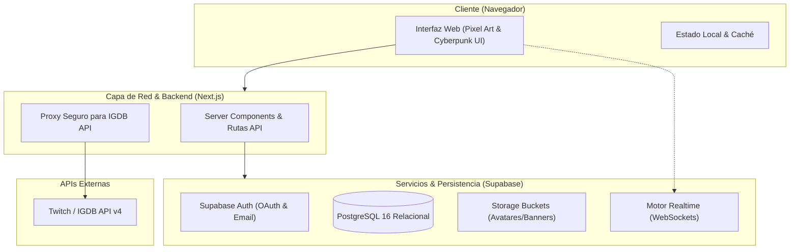
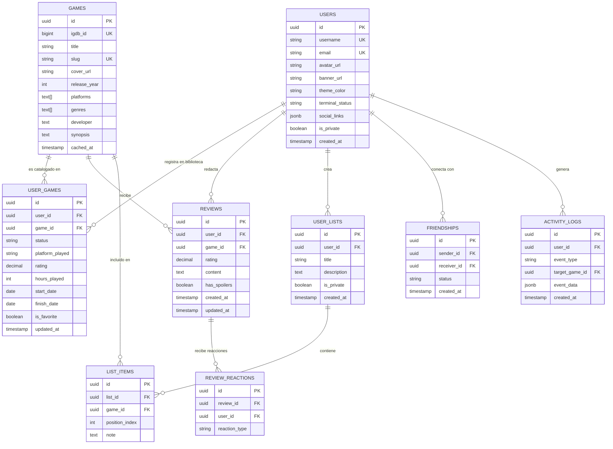

# 03. Arquitectura del Sistema y Modelo de Datos

---

## 1. Visión General del Patrón Arquitectónico

**SaveState** implementa una arquitectura **Fullstack Serverless / Híbrida** basada en Next.js (App Router) con renderizado en el servidor (SSR / Server Components) y un Backend as a Service gestionado con **Supabase (PostgreSQL 16)**.

---

## 2. Modelo Entidad-Relación (ERD)

---

## 3. Seguridad y Políticas RLS (Row Level Security)

* **Políticas de Lectura Pública:** Fichas de juegos, listas marcadas como públicas y perfiles sin restricción son legibles por cualquier usuario (incluso visitantes anónimos).
* **Políticas de Escritura:** Exclusivas para usuarios autenticados donde `auth.uid() = user_id`.
* **Privacidad de Perfil:** Si un perfil está marcado como privado, únicamente los usuarios con un registro aceptado en `FRIENDSHIPS` tienen acceso a su biblioteca y reseñas.
* **Sanitización de Markdown:** Todo texto pasa por `isomorphic-dompurify` antes del guardado y del renderizado para evitar ataques XSS.
