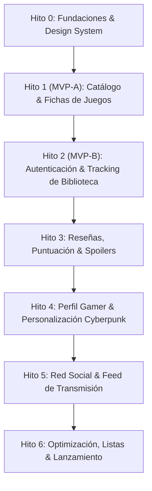

# 07. Roadmap del Proyecto por Hitos

---

## 1. Cronograma de Hitos y Entregables

* **Hito 0 (Fundaciones):** Tokens de estilo Tailwind v4, tipografías Silkscreen / JetBrains Mono, primitivos HUD y conmutador CRT.
* **Hito 1 (Catálogo y Búsqueda - MVP Parte 1):** Proxy seguro IGDB, buscador global con `Ctrl + K`, filtros por consola/año/género y fichas de juegos con caché.
* **Hito 2 (Autenticación y Tracking - MVP Parte 2):** Supabase Auth, gestión de los 6 estados de biblioteca (`Playing`, `Backlog`, `Cleared`, `100%`, `Dropped`, `Wishlist`), registro de plataforma y horas.
* **Hito 3 (Reseñas, Puntuación y Spoilers):** Editor Markdown sanitizado, escala de puntuación gráfica, filtro interactivo anti-spoilers y reacciones temáticas.
* **Hito 4 (Perfil Gamer Cyberpunk):** Top 4 juegos fijados, personalización de banners, avatares pixel art, temas de acento neón, terminal bash y estadísticas del jugador.
* **Hito 5 (Red Social y Feed):** Sistema de amigos y seguimiento, feed en tiempo real con WebSockets y listas de juegos compartibles.
* **Hito 6 (Optimización y Lanzamiento):** Auditorías Lighthouse (>90), compresión WebP y despliegue final en producción.
