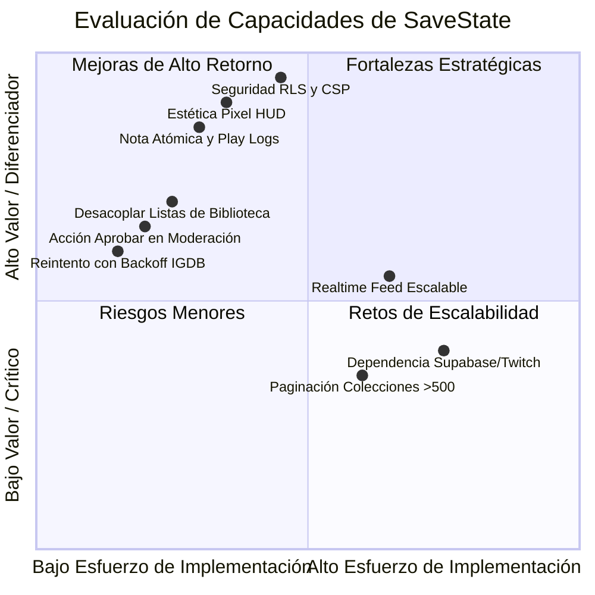

# Análisis Integral: Puntos Fuertes, Limitaciones y Áreas de Mejora — SaveState

**Fecha:** 7 de octubre de 2026  
**Rama:** `research/antigravity`  
**Referencia:** Código auditado (`src/`, `supabase/`, `tests/`), documentos fundacionales `01`–`07` y decisiones aprobadas.

---

## 1. Resumen Ejecutivo

SaveState es un proyecto con una **personalidad arquitectónica y visual sobresaliente**. A diferencia de los clones convencionales de catalogación, adopta una estética retro-futurista de terminal cyberpunk y un modelo de seguridad *Zero-Trust* centrado en PostgreSQL y Next.js 16.

Este documento desglosa objetivamente tanto las **grandes virtudes de ingeniería y producto** como las **debilidades estructurales, compromisos (*trade-offs*) y limitaciones actuales**, sirviendo como base de discusión técnica para el equipo de desarrollo.

---

## 2. Puntos Fuertes (Pros y Fortalezas)

### 💎 A. Identidad Visual y Experiencia de Usuario Temática
* **Diferenciación radical de producto:** No es una interfaz blanca y minimalista. Utiliza tokens de diseño cyberpunk (`void-950`, `neon-cyan`, `acid-green`, `synth-pink`, `retro-amber`) y componentes con bordes biselados/escalonados estilo HUD.
* **Dualidad tipográfica intencional:** Combina *Silkscreen* (pixel art) para títulos, estados y métricas con *JetBrains Mono* para sinopsis y reseñas largas, garantizando legibilidad sin romper la inmersión retro.
* **Accesibilidad real conmutada:**
  * Efecto CRT con líneas de escaneo conmutable por el usuario y persistido en `localStorage`.
  * Detección activa de `prefers-reduced-motion` que desactiva el confeti de canvas al marcar juegos en estado *Platinum / 100%*.
  * Contraste revisado para cumplir el estándar WCAG AA.

### 🛡️ B. Seguridad en Profundidad (*Defense in Depth*)
* **Aislamiento en Base de Datos (14 tablas con RLS estricto):**
  * La seguridad no recae en la capa de Node/React. Toda consulta a PostgreSQL pasa por políticas de *Row Level Security* con funciones especializadas (`can_view_library()`, `can_view_review()`).
  * Un usuario con biblioteca privada jamás expone sus registros, logs, reseñas o favoritos a visitantes no aprobados, incluso si se realizan consultas directas.
* **Intermediación de Red Moderna (Next.js 16 `src/proxy.ts`):**
  * Inyección en cada respuesta de una directiva `Content-Security-Policy` dinámica con `nonce` único criptográfico.
  * Encabezados automáticos `Cache-Control: private, no-store` para rutas privadas, evitando contaminación de cachés intermedias.
  * Aislamiento estricto de secretos de servidor mediante `server-only`.
* **Sanitización de Contenido de Reseñas (Prevención XSS):**
  * Doble filtro estricto con `isomorphic-dompurify` tanto antes de la persistencia como antes de renderizar el HTML procesado por `marked`.

### 🎯 C. Coherencia y Robustez del Modelo de Dominio
* **Nota Única y Atómica:**
  * Resuelve la inconsistencia clásica de plataformas sociales: la puntuación de 1 a 10 (con incrementos de 0.5) reside exclusivamente en `user_games.rating` (`mod(rating, 0.5) = 0`). Las reseñas no duplican la nota; una transacción PostgreSQL actualiza ambos registros simultáneamente.
* **Múltiples Play Logs por Juego:**
  * A diferencia de sistemas simplistas que solo guardan "horas totales", SaveState permite múltiples sesiones históricas de juego (`play_logs`), registrando plataforma, método (consola real vs. emulador), fechas de inicio/fin, dificultad y horas dedicadas.
* **Top 4 Favoritos Validado Atómicamente:**
  * Función `set_favorites(uuid[])` en PostgreSQL que garantiza orden de 1 a 4, unicidad y cardinalidad máxima en una sola operación transaccional.

### ⚡ D. Resiliencia ante APIs Externas y Límites de Tasa
* **Presupuesto Atómico Compartido:**
  * Implementación de la función `claim_igdb_request()` que protege el límite de Twitch (< 4 peticiones/segundo) entre todas las instancias del servidor.
* **Caché Inteligente e Ingesta Perezosa:**
  * `unstable_cache` de 24 horas y almacenamiento local de títulos en `games` conforme se buscan, reduciendo el consumo externo.
* **Modo de Contingencia Elegante:**
  * Si la API de IGDB se cae o faltan credenciales, el sistema no colapsa: conmuta automáticamente al catálogo previamente almacenado en PostgreSQL (`localCatalogue`).

### 🧪 E. Calidad de Código y Cero Deuda de Testing
* **Stack Moderno y Ligero:**
  * Utiliza el test runner nativo de **Node.js 24** (`node --test`), evitando librerías de prueba pesadas y complejas de mantener.
  * Tipado estricto de TypeScript 5 con ESLint 9 configurado para accesibilidad y hooks de React.
  * Cero dependencias innecesarias o desactualizadas en el núcleo.

---

## 3. Puntos Débiles, Limitaciones y Contras (Trade-offs)

### ⚠️ A. Alta Dependencia de Aprovisionamiento Externo (Barrera de Despliegue)
* **El Problema:** La aplicación no es autónoma para una puesta en marcha inmediata. Requiere obligatoriamente dos servicios externos con cuentas de desarrollador activas:
  1. **Twitch Developer:** Para obtener Client ID y Secret para la API IGDB v4.
  2. **Supabase:** Para la base de datos relacional PostgreSQL, Auth (Google/Discord) y Storage (avatares/banners).
* **Impacto:** Sin configurar estos servicios en `.env.local` o en la plataforma de despliegue, la aplicación funciona en modo degradado (no inventa datos, bloquea mutaciones y el catálogo permanece vacío).

### ⚠️ B. Sobrecarga Potencial del Canal Realtime en el Feed Comunitario
* **El Problema:** En `src/components/realtime-feed.tsx`, el cliente se suscribe mediante WebSockets a todos los eventos de inserción en la tabla `activity_logs`.
* **El Riesgo:** Cuando la plataforma tenga una comunidad con actividad simultánea continua, cada checkpoint o partida completada por cualquier usuario emitirá un evento que disparará un `router.refresh()` en todos los navegadores conectados.
* **Impacto:** Aunque existe un debounce de 500 ms, generará una sobrecarga considerable de peticiones concurrentes de Server Components dirigidas al servidor Next.js.

### ⚠️ C. Degradación Prematura en Búsquedas IGDB Concurrente Fría
* **El Problema:** El presupuesto atómico de IGDB (`claim_igdb_request`) utiliza un cerrojo con ventana de 270 ms en PostgreSQL para cumplir la tasa de Twitch.
* **El Riesgo:** Si dos usuarios buscan simultáneamente títulos que aún no están en la base de datos local, solo uno obtiene permiso para consultar IGDB; el segundo entra inmediatamente en contingencia (`localCatalogue`).
* **Impacto:** El segundo usuario recibirá 0 resultados en pantalla en lugar de esperar 300 ms con un reintento suave (*backoff*).

### ⚠️ D. Fricción de Experiencia en la Creación de Listas Temáticas
* **El Problema:** En la vista `/lists/[id]`, el formulario para incorporar juegos a una lista temática se nutre exclusivamente de los juegos registrados en la biblioteca del usuario (`user_games`).
* **Impacto:** Si un jugador desea crear una lista de *"Top 10 joyas ocultas de Game Boy"* o recomendaciones para sus amigos, está forzado a agregarlas primero a su propia biblioteca, contaminando sus estadísticas de juego o su backlog personal.

### ⚠️ E. Flujo Administrativo Truncado en Sugerencias de Catálogo
* **El Problema:** Los usuarios pueden sugerir títulos retro o romhacks no indexados en IGDB (`RF-09`). En el panel `/moderation`, el moderador puede visualizar el listado de sugerencias.
* **Impacto:** La interfaz carece de una acción con un clic ("Aprobar e indexar en catálogo"). El administrador está obligado a ejecutar una sentencia SQL manual para transformar la sugerencia en una fila definitiva de `games`.

### ⚠️ F. Escalabilidad de la Biblioteca: Límite Rígido de 500 Juegos
* **El Problema:** Las consultas de biblioteca cargan colecciones completas con un tope arbitrario de 500 títulos.
* **Impacto:** Para jugadores retro con colecciones masivas o *speedrunners*, la biblioteca alcanzará un límite visual y de datos que requerirá implementar paginación por cursor en fases posteriores.

---

## 4. Matriz Comparativa (Balance Pros vs. Contras)

---

## 5. Recomendaciones de Evolución (Roadmap Técnico Sugerido)

Para consolidar las fortalezas y subsanar las debilidades sin desvirtuar el stack aprobado:

1. **Corto Plazo (Quick Wins sin impacto arquitectónico):**
   * **Buscador global en listas:** Permitir buscar en `games` o en el endpoint de catálogo desde `ListItemForm` para armar listas sin contaminar `user_games`.
   * **Reintento con backoff en IGDB:** Añadir una espera de 300 ms en el backend antes de caer a la contingencia local si el cerrojo atómico rechaza el primer intento.
   * **Botón de aprobación en `/moderation`:** Cerrar el flujo de sugerencias comunitarias con una acción directa de inserción en base de datos.

2. **Medio Plazo (Previo al lanzamiento con tráfico real):**
   * **Optimización del Feed:** Reemplazar el `router.refresh()` incondicional por un indicador visual en el HUD (*"◆ 1 nuevo evento en transmisión — Sincronizar"*).
   * **Configuración y prueba de servicios externos:** Completar la verificación de firmas JWT de Supabase Auth, WebSockets reales y latencia de IGDB mediante despliegue en Vercel.

3. **Largo Plazo (Fase 2):**
   * **Paginación por cursor:** En bibliotecas y catálogo para soportar colecciones mayores a 500 juegos.
   * **Integración con Steam:** Conforme al alcance diferido acordado en `decisiones_aprobadas.md`.
