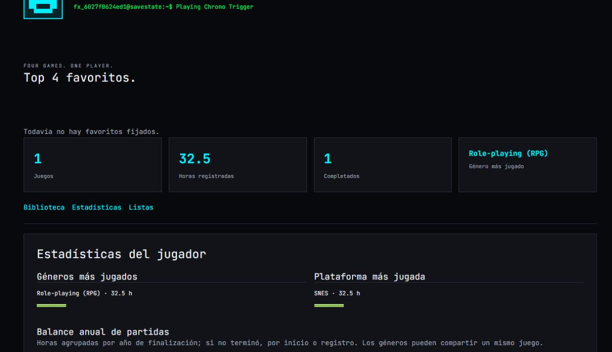
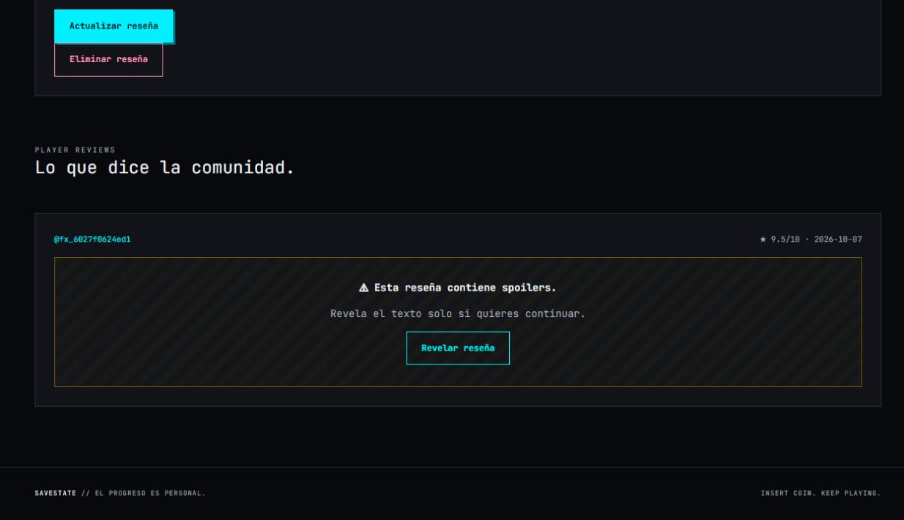

# Animaciones retro accesibles

Implementación de los dos efectos solicitados el 7 de octubre de 2026, siguiendo la propuesta de `research/antigravity` conservada en `propuesta_animaciones_reactbits.md`. Componentes propios inspirados en los efectos de React Bits; no se instala React Bits, Motion ni otra dependencia.

- `DecryptedText`: descifrado de 650 ms, limitado a una actualización visual cada 45 ms, en el terminal del perfil público y al revelar spoilers. La reseña mantiene el HTML sanitizado y su formato; la capa aleatoria usa solo `textContent` y queda oculta para lectores de pantalla.
- `NumberTicker`: progresión de 800 ms para juegos, horas (un decimal) y completados, mediante `PlayerSummary` en `player-statistics.tsx`. Mantiene los cálculos y límites de biblioteca anteriores.
- Los efectos se activan una vez al entrar en pantalla mediante IntersectionObserver y usan requestAnimationFrame, con limpieza al desmontar. El servidor renderiza el resultado final, sin números o caracteres aleatorios en el HTML inicial.
- `prefers-reduced-motion: reduce` evita programar frames y muestra inmediatamente el resultado. Activarlo durante un efecto cancela el trabajo pendiente. CSS garantiza el contenido estático incluso antes de la hidratación. Los lectores de pantalla reciben siempre las cifras y textos finales.
- La vista previa de ajustes conserva el terminal estático para no animar cada pulsación al editar.

## Validación

`npm run check` correcto: lint, tipos estrictos, formato y 18 tests. Dos pruebas nuevas verifican movimiento reducido, cambio de preferencia, espera de visibilidad, resultado final y cancelación/limpieza. Build de producción local correcto. Verificación visual con perfil privado temporal: 32.5 horas, 1 completado y reseña con formato y spoiler. Los datos de prueba se eliminan al finalizar.

El navegador de pruebas tiene movimiento reducido activo: se comprobaron las cifras estáticas visibles, el terminal final y la revelación inmediata con negritas conservadas. Se restablecen tanto `clip` como `clip-path` de la utilidad sr-only en ese modo. La progresión normal y su limpieza se verificaron con los tests de frames/visibilidad. Consola del navegador sin errores. La cuenta privada temporal y sus datos se eliminaron tras la comprobación.

Publicado el 7 de octubre de 2026 con `npx --no-install vercel --prod --yes`, commit `6db56b1`. Vercel confirmó READY, Next.js 16.4.0 y build remoto correcto (11 s).

URL de producción: https://savestate-eight.vercel.app. Despliegue: `dpl_92uQc9aWW6677EMRgSja3d3229uz`.

Comprobación posterior: inicio y `/players/ilhamelin` responden HTTP 200 con CSP y nonce; el perfil sirve el terminal accesible y los contadores del nuevo build. La revisión inicial de registros del despliegue no encontró errores. Las comprobaciones autenticadas de spoiler y cifras se realizaron localmente con la cuenta privada temporal indicada arriba.

Referencia de inspiración: https://reactbits.dev/c/text-animations.
