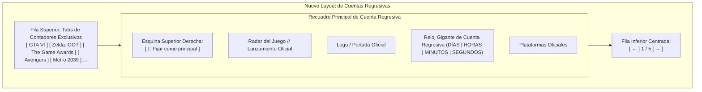

# Especificación Técnica: Reubicación de Botón Fijar, Navegación Inferior y Contador "Metro 2039"

---

## 1. Resumen y Objetivos del Rediseño de Layout

Con base en el mockup wireframe del usuario (adjunto en la imagen), se optimiza la disposición espacial del carrusel de cuentas regresivas para permitir la escalabilidad de muchos más contadores (1, 2, 3, 4, 5, etc.) de forma limpia y ergonómica:



### Cambios de Arquitectura UI:
1. **Botón Fijar en la Esquina Superior Derecha del Recuadro**:
   - Se retira de la barra superior y se inserta **directamente dentro del recuadro** de la cuenta regresiva (`.gta6-countdown-banner`), alineado en la esquina superior derecha (`position: absolute; top: 1.25rem; right: 1.25rem;`).
   - Mantiene la funcionalidad de persistencia en `localStorage` (`savestate_pinned_countdown`), con estado activo resplandeciente (`is-pinned`) e icono `📌`.

2. **Navegación del Carrusel (`← 1 / 5 →`) Centrada al Pie del Recuadro**:
   - Los botones de navegación anterior/siguiente y el contador de posición (`X / Y`) se mueven a una nueva barra al pie del componente (`.countdown-slider-footer`), centrada horizontalmente justo debajo del recuadro del reloj.

3. **Barra Superior Exclusiva para Pestañas (Tabs)**:
   - Al trasladar tanto el botón fijar como los controles de flechas, la barra superior queda **100% dedicada a las pestañas de títulos**, permitiendo que crezca con muchos más contadores sin apretarse ni romper el diseño en pantallas móviles.

4. **Nuevo Contador Oficial: Metro 2039**:
   - Fecha: **4 de febrero de 2027** (`2027-02-04T00:00:00.000Z`).
   - Plataformas: PC (Steam), PlayStation 5, Xbox Series X|S.
   - Recursos gráficos listos en `public/metro/` (`hero.jpg`, `icon.png`, `icon-128.png`, `icon-512.png`, `logo.png`).
   - Estética ámbar radiactiva `.countdown-theme-metro`.

---

## 2. Modificaciones al Componente (`src/components/gta6-countdown.tsx`)

```tsx
<div className="countdown-showcase">
  {/* 1. Barra de pestañas exclusiva en la parte superior */}
  <div className="countdown-selector-bar">
    <div className="countdown-tabs" role="tablist" aria-label="Selector de cuentas regresivas">
      {RELEASE_COUNTDOWNS.map((item, index) => (
        <button
          key={item.id}
          ref={(node) => { tabs.current[index] = node; }}
          id={`${id}-tab-${item.id}`}
          type="button"
          role="tab"
          aria-selected={index === activeIndex}
          aria-controls={`${id}-panel`}
          tabIndex={index === activeIndex ? 0 : -1}
          className={`countdown-tab ${index === activeIndex ? 'active' : ''}`}
          onClick={() => setActiveIndex(index)}
          onKeyDown={(event) => keydown(event, index)}
        >
          <Image src={item.iconImage} alt="" width={20} height={20} unoptimized />
          <span className="countdown-tab-index">{item.tabNumber}</span>
          <span>{item.tabLabel}</span>
          {item.id === pinnedId && (
            <span className="countdown-tab-pin-badge" title="Fijado como principal" aria-hidden="true">
              📌
            </span>
          )}
        </button>
      ))}
    </div>
  </div>

  {/* 2. Recuadro principal de la cuenta regresiva con botón Fijar en la esquina superior derecha */}
  <section
    id={`${id}-panel`}
    role="tabpanel"
    aria-labelledby={`${id}-tab-${active.id}`}
    className={`gta6-countdown-banner ${active.themeClass}`}
    style={{ '--countdown-hero': `url("${active.heroImage}")` } as CSSProperties}
  >
    <button
      type="button"
      className={`countdown-pin-btn${pinnedId === active.id ? ' is-pinned' : ''}`}
      onClick={() => togglePin(active.id)}
      aria-pressed={pinnedId === active.id}
      title={
        pinnedId === active.id
          ? 'Contador fijado como principal (clic para desfijar)'
          : 'Fijar este contador como principal al ingresar a SaveState'
      }
    >
      <span aria-hidden="true">{pinnedId === active.id ? '📌' : '📍'}</span>
      <span>{pinnedId === active.id ? 'Fijado' : 'Fijar'}</span>
    </button>

    <p className="gta6-radar">
      <Image src={active.iconImage} alt="" width={40} height={40} unoptimized />
      {active.radarLabel}
    </p>

    <h2>
      <Image src={active.logoImage} alt={active.title} width={260} height={170} className="gta6-logo" unoptimized />
    </h2>
    <p>{active.releaseText}</p>

    <div className="gta6-platforms">
      {active.platforms.map((platform) => (
        <span className="platform-tag" key={platform.label}>
          <Image src={platform.icon} alt="" width={18} height={18} unoptimized />
          {platform.label}
        </span>
      ))}
    </div>

    {countdown?.released ? (
      <p className="gta6-released">{active.releasedText}</p>
    ) : (
      <div className="gta6-clock" role="timer" aria-label={active.timerAriaLabel} aria-live="off">
        {(['days', 'hours', 'minutes', 'seconds'] as const).map((key, index) => (
          <div key={key}>
            <strong>{countdown ? String(countdown[key]).padStart(2, '0') : '—'}</strong>
            <span>{['DÍAS', 'HORAS', 'MINUTOS', 'SEGUNDOS'][index]}</span>
          </div>
        ))}
      </div>
    )}

    <small className="muted">{active.referenceNote}</small>
  </section>

  {/* 3. Controles del carrusel centrados al pie del recuadro */}
  <div className="countdown-slider-footer">
    <button
      type="button"
      className="button outline small"
      aria-label="Contador anterior"
      onClick={() =>
        setActiveIndex(
          (previous) => (previous - 1 + RELEASE_COUNTDOWNS.length) % RELEASE_COUNTDOWNS.length,
        )
      }
    >
      ←
    </button>
    <span className="countdown-slider-status" aria-live="polite">
      {activeIndex + 1} / {RELEASE_COUNTDOWNS.length}
    </span>
    <button
      type="button"
      className="button outline small"
      aria-label="Siguiente contador"
      onClick={() => setActiveIndex((previous) => (previous + 1) % RELEASE_COUNTDOWNS.length)}
    >
      →
    </button>
  </div>
</div>
```

---

## 3. Estilos CSS Requeridos (`src/app/globals.css`)

```css
/* Posicionamiento del botón Fijar en la esquina superior derecha del recuadro */
.gta6-countdown-banner {
  position: relative;
}
.gta6-countdown-banner .countdown-pin-btn {
  position: absolute;
  top: 1.25rem;
  right: 1.25rem;
  z-index: 5;
}
@media (max-width: 600px) {
  .gta6-countdown-banner .countdown-pin-btn {
    top: 0.75rem;
    right: 0.75rem;
    font-size: 0.68rem;
    padding: 3px 8px;
  }
}

/* Controles de slider centrados al pie */
.countdown-slider-footer {
  display: flex;
  align-items: center;
  justify-content: center;
  gap: 0.75rem;
  margin-top: 1rem;
}

/* Barra superior de pestañas full width */
.countdown-selector-bar {
  display: flex;
  width: 100%;
  margin-bottom: 0.75rem;
}
.countdown-tabs {
  display: flex;
  gap: 0.5rem;
  flex-wrap: wrap;
  width: 100%;
}
```
