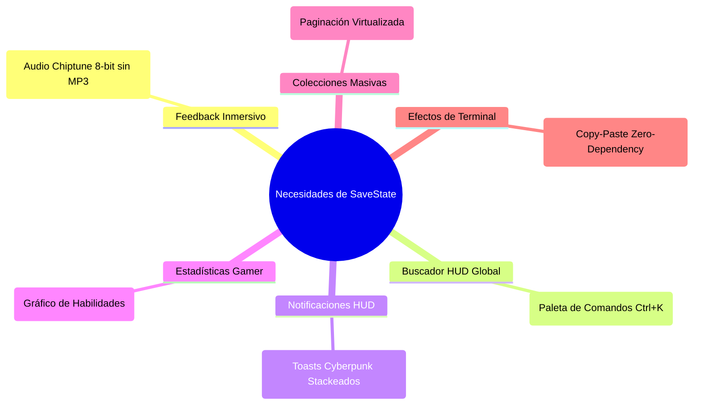

# Investigación Minuciosa: Bibliotecas Candidatas para Potenciar SaveState

**Fecha:** 7 de octubre de 2026  
**Rama:** `research/antigravity`  
**Referencia:** Requerimientos fundacionales (`01`–`07`), decisiones aprobadas, análisis de puntos débiles y arquitectura actual (**Next.js 16 App Router, React 19, TypeScript 5, Tailwind CSS v4, Supabase, Node 24**).

---

## 1. Criterios de Selección y Filtro Arquitectónico

Toda biblioteca evaluada en este informe ha sido contrastada contra las restricciones estrictas del proyecto:
1. **Compatibilidad nativa con React 19 y Server Components (Next.js 16):** Cero conflictos de *peer dependencies* o dependencias obsoletas.
2. **Impacto mínimo en el Bundle (Lightweight):** Priorizar soluciones modulares o generativas frente a frameworks monolíticos.
3. **Respeto a la Accesibilidad (RNF-05):** Soporte nativo para lectores de pantalla y directiva `prefers-reduced-motion`.
4. **Coherencia Temática:** Adaptabilidad total a la identidad visual **Cyberpunk / Retro HUD / Pixel Art** con Tailwind CSS v4.
5. **Seguridad y Mantenimiento:** Cero vulnerabilidades conocidas en `npm audit` y licencias permisivas (MIT/Apache 2.0).

---

## 2. Mapa de Necesidades vs. Soluciones Tecnológicas



---

## 3. Análisis Detallado por Biblioteca

---

### 1. `ZzFX` — Efectos de Sonido Chiptune Procedurales (8-bit)
* **Necesidad en SaveState:**
  El diseño visual simula un HUD retro-futurista de consola gamer, pero la interacción táctil/auditiva es silenciosa. Se requiere feedback de sonido para acciones clave: clic en botones HUD, marcar un juego como `Platinum` (subida de nivel), o asestar un *Critical Hit* en una reseña.
* **Por qué NO usar librerías tradicionales (Howler.js / archivos .mp3):**
  Cargar archivos de audio estáticos `.mp3` o `.wav` infla el consumo de red, requiere almacenamiento y agrega latencia de descarga.
* **La Solución (`ZzFX` / micro-synthesizer):**
  * **Tamaño:** **< 1 KB** (literalmente una función de 30 líneas de código).
  * **Mecánica:** Utiliza la Web Audio API nativa del navegador para generar ondas cuadradas, de sierra y ruido blanco procedurales a partir de un array de números.
  * **Ejemplo de sonido retro:**
    ```typescript
    // Sonido de 'Critical Hit' / Logro desbloqueado
    zzfx(...[1.5, 0, 440, 0.05, 0.2, 0.3, 1, 1.8, , , , , , 0.1, , 0.1, 0.05, 0.8, 0.05]);
    ```
* **Ventajas:**
  * Cero archivos que descargar del servidor.
  * Sonido chiptune 100% auténtico de los 80/90.
  * Silenciable al instante si el usuario apaga los efectos de sonido en la configuración de accesibilidad.
* **Veredicto:** **Altamente Recomendada** (puede incorporarse como un módulo helper interno en `src/lib/sound.ts` sin instalar paquetes pesados).

---

### 2. `cmdk` — Paleta de Comandos HUD Global (`Ctrl + K`)
* **Necesidad en SaveState:**
  En los wireframes de [docs/diseno_y_plan_savestate.md](diseno_y_plan_savestate.md) y en [docs/roadmap_savestate.md](roadmap_savestate.md) (Hito 1) se definió: `[🔍 Buscar juego... (Ctrl+K)]`. El usuario debe poder saltar rápidamente a cualquier juego, lista o perfil desde cualquier pantalla.
* **La Solución (`cmdk` por Paco Coursey):**
  * La biblioteca estándar de la industria utilizada por Vercel, Linear y Raycast para interfaces de teclado.
  * **Tamaño:** ~6 KB gzipped.
  * **Compatibilidad:** Headless y 100% desacoplada del diseño; se estiliza directamente con clases Tailwind CSS v4 para crear una ventana flotante de terminal hacker (`bg-surface-900 border-neon-cyan/40`).
* **Ventajas:**
  * Accesibilidad WCAG total (navegación con flechas, atajos de teclado y ARIA combobox).
  * Soporte de filtrado rápido y debounce para el catálogo de IGDB/PostgreSQL.
* **Veredicto:** **Imprescindible para cumplir el Hito 1 con calidad de producción.**

---

### 3. `sonner` — Sistema de Toasts y Notificaciones HUD
* **Necesidad en SaveState:**
  El requisito `RF-29` exige notificaciones internas para nuevos seguidores, comentarios en reseñas y solicitudes de amistad aceptadas. En el frontend se requiere un sistema de aviso no intrusivo pero estéticamente integrado al HUD.
* **La Solución (`sonner` por Emil Kowalski):**
  * Biblioteca de toasts moderna, ligera y líder en el ecosistema React.
  * **Tamaño:** ~4 KB.
  * **Compatibilidad:** Soporte nativo para React 19 y Server Actions en Next.js App Router.
* **Ventajas:**
  * Toasts apilables (*stacked*) con micro-animaciones fluidas.
  * Personalización extrema: permite definir variantes con borde de neón (`theme-cyan`, `theme-pink`, `theme-green`).
  * Respeta `prefers-reduced-motion` automáticamente.
* **Veredicto:** **Recomendada** (sustituye alertas nativas por feedback cyberpunk reactivo).

---

### 4. `@visx/shape` y `@visx/scale` — Gráfico de Radar / Estadísticas Gamer
* **Necesidad en SaveState:**
  El documento fundacional `01_definicion_de_idea.md` (y `RF-25`) especifica: *"Gráficos estilo radar / estadísticas pixel art: géneros más jugados, consola favorita, total de horas dedicadas"*.
* **Por qué NO usar Chart.js o Recharts completo:**
  Chart.js depende de canvas y es difícil de sincronizar con temas CSS dinámicos de Tailwind. Recharts arrastra un bundle considerable (>150 KB) y ocasionalmente presenta discrepancias de tipos con React 19.
* **La Solución (`@visx` de Airbnb):**
  * Primitivas modulares de SVG puras sobre React. Solo se instala `@visx/shape` (~12 KB) para el polígono de radar.
* **Ventajas:**
  * Renderiza SVG puro en el DOM, lo que permite aplicarle filtros CSS de resplandor neón (`filter: drop-shadow(0 0 8px #00F0FF)`).
  * Totalmente reactivo a las paletas de colores del perfil del jugador (`theme_color`).
* **Veredicto:** **Ideal para el módulo de estadísticas de perfiles (`RF-25`).**

---

### 5. `@tanstack/react-virtual` — Virtualización para Bibliotecas Masivas (>500 juegos)
* **Necesidad en SaveState:**
  Identificado en el análisis de limitaciones: las colecciones masivas de jugadores retro o coleccionistas con cientos de títulos pueden degradar el rendimiento del navegador al renderizar cientos de `GameCard` con carátulas de alta resolución simultáneamente.
* **La Solución (`@tanstack/react-virtual` v3):**
  * Virtualizador headless agnóstico, compatible con React 19 y grids de CSS.
  * **Tamaño:** ~3 KB gzipped.
* **Ventajas:**
  * Solo mantiene en el DOM las tarjetas visibles en el viewport, reduciendo el consumo de memoria del navegador a una fracción mínima.
  * Permite scroll infinito fluido a 60 fps en móvil y escritorio sin límites rígidos de 500 juegos.
* **Veredicto:** **Recomendada para la Fase 2 de optimización de biblioteca.**

---

### 6. Componentes Generativos `React Bits` (Enfoque Copy-Paste)
* **Necesidad en SaveState:**
  Efectos de terminal hacker como texto desencriptado (`DecryptedText`) y contadores numéricos de estadísticas (`NumberTicker`).
* **La Estrategia:**
  No instalar librerías npm para estos efectos. Se incorporan como archivos TypeScript independientes y testeables en `src/components/ui/` bajo la filosofía de código abierto copy-paste.
* **Veredicto:** **Aprobada en `docs/propuesta_animaciones_reactbits.md`.**

---

## 4. Matriz Comparativa y Resumen de Adopción

| Biblioteca | Categoría | Tamaño | Dependencias | Prioridad | Propósito en SaveState |
|---|---|---|---|---|---|
| **`ZzFX`** | Audio Chiptune | **< 1 KB** | 0 (Código local) | **Alta** | Efectos de sonido retro para logros, clics y Platinum |
| **`cmdk`** | UI / Navegación | **~6 KB** | 0 | **Alta** | Modal global de búsqueda `Ctrl + K` de catálogo |
| **`sonner`** | Notificaciones | **~4 KB** | 0 | **Media** | Avisos HUD para seguimiento, amistad y reseñas |
| **`@visx/shape`** | Data Visualization | **~12 KB** | Mínimas | **Media** | Radar de estadísticas de géneros y consolas (RF-25) |
| **`@tanstack/react-virtual`** | Rendimiento | **~3 KB** | 0 | **Fase 2** | Scroll virtualizado para bibliotecas de gran tamaño |

---

## 5. Próximos Pasos Sugeridos

1. **Paso 1 (Inmediato):** Presentar esta evaluación técnica al equipo / Codex para seleccionar el orden de incorporación.
2. **Paso 2:** Comenzar por las dos mejoras de mayor retorno y menor tamaño:
   * Implementación de la paleta `Ctrl + K` con `cmdk`.
   * Integración del micro-módulo de síntesis de audio retro `ZzFX`.
