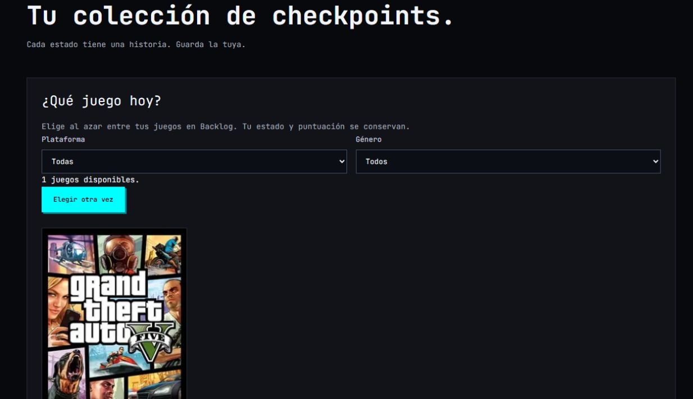

# Mejoras de descubrimiento y biblioteca

Alcance aprobado por el usuario el 7 de octubre de 2026: implementar las cuatro propuestas de descubrimiento, agregado rápido, listas de catálogo y selección aleatoria del backlog. Extiende las decisiones originales del MVP sin cambiar arquitectura ni tecnologías.

- **Explorar:** orden por relevancia aproximada (cantidad de opiniones en IGDB), lanzamientos recientes sin fechas futuras y clásicos publicados antes de 2010. La relevancia de IGDB no es la nota comunitaria de Savestate. Páginas de 24 juegos, máximo 41 páginas por consulta; búsqueda y filtros quedan en la URL para recuperar al volver de una ficha. Cada página mantiene los identificadores y el orden exactos de IGDB, con caché de 24 horas y notas comunitarias consultadas sin caché. El filtro comunitario se aplica a cada página; una página vacía puede tener páginas siguientes.
- **Agregado rápido:** acciones Backlog, Wishlist y Playing desde las tarjetas de Explorar. Requiere sesión. Si el juego ya está guardado, conserva su estado, nota y favoritos; muestra el estado existente. La actualización de un juego existente sigue disponible en Biblioteca.
- **Listas:** buscador de catálogo con «Cargar más resultados» para añadir un juego aunque no esté en la biblioteca. La selección no crea una entrada de biblioteca. Las posiciones, notas, privacidad y autorización RLS existentes se conservan.
- **Qué juego hoy:** en la biblioteca propia, elección aleatoria uniforme entre entradas Backlog, con filtros de plataforma y género. No modifica datos. Usa los juegos cargados por la biblioteca (límite existente de 500 entradas recientes más favoritos).

No se añaden dependencias ni migraciones. La contingencia local mantiene paginación por fecha/año entre los títulos almacenados; no reproduce la relevancia de IGDB ni puede verificar el día exacto de lanzamiento, porque el modelo local conserva el año.

## Validación

Comprobaciones realizadas el 7 de octubre de 2026, desde un servidor de producción local en `http://localhost:3004`, con Supabase e IGDB reales:

- `npm run check`: lint, tipos estrictos, 16 tests unitarios y formato correctos.
- `npm run build`: correcto; reconoce `src/proxy.ts` y todas las rutas.
- Prueba de integración de descubrimiento: 1 test aprobado en el build final. Verifica 48 títulos IGDB en dos páginas sin duplicados, orden de clásicos/recientes, rechazo de páginas inválidas, agregado idempotente que conserva Backlog/9.5/Top 1 y creación/edición de listas sin alterar la biblioteca.
- Navegador: «Cargar más» llegó a 48 resultados; agregado de Portal desde una tarjeta confirmado; vuelta desde la ficha recuperó búsqueda Portal y orden Clásicos; selección de un juego del backlog visible; búsqueda y guardado de Chrono Trigger (1995) en una lista confirmados con «Guardado».
- Las cuentas temporales de las comprobaciones se eliminaron junto con sus datos dependientes. No se modificó la cuenta del usuario.

La prueba externa exige activación explícita y un servidor local; crea su propia cuenta y la limpia en `finally`. Para repetirla con las credenciales de `.env.local`:

```powershell
$env:TEST_DISCOVERY_LIVE = '1'
$env:TEST_APP_URL = 'http://localhost:3004'
node --env-file=.env.local --experimental-strip-types --test tests/integration/discovery.test.ts
```

Las mejoras están verificadas localmente y pendientes de un nuevo despliegue de producción. No requieren variables nuevas ni cambios en Supabase.



Referencia del proveedor para orden, filtros y paginación: https://api-docs.igdb.com/.
