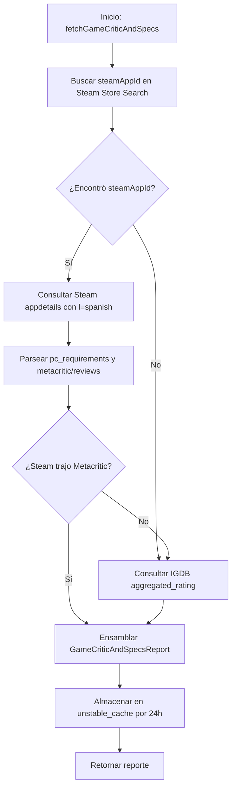

# SPEC-17: Consenso de Crítica Profesional y Requisitos de Hardware PC

## 1. Objetivo y Contexto del Proyecto

SaveState cuenta con telemetría comunitaria en vivo, durómetro y compatibilidad con consolas portátiles (SPEC-16). Sin embargo, los jugadores necesitan responder dos preguntas cruciales antes de iniciar o comprar un juego:
1. **¿Qué opina la prensa especializada internacional?** (Puntuación oficial de Metacritic y consenso crítico).
2. **¿Lo corre mi PC?** (Requisitos mínimos y recomendados oficiales de hardware en español: CPU, GPU, RAM, almacenamiento y DirectX).

### Decisiones de Arquitectura y Viabilidad Técnica
* **Cero Costo / Cero Claves:** Las APIs externas de OpenCritic y RAWG requieren suscripciones y llaves de RapidAPI con límites mensuales estrictos. En su lugar, aprovechamos la **Steam Store API oficial** (`https://store.steampowered.com/api/appdetails?appids=${appId}&l=spanish`), la cual es **100% gratuita, pública y sin claves**, y ya cuenta con el flujo de resolución de `steamAppId` implementado en SaveState.
* **Cobertura Consola / Fallback IGDB:** Si un juego es exclusivo de consolas o no posee ficha en Steam, se utiliza el campo `aggregated_rating` de la API de IGDB como fallback para la crítica profesional, y se muestra un estado amigable indicando que es un título de consola que no requiere hardware de PC.
* **Aislamiento y Caché:** Las consultas se ejecutan de manera resiliente con `unstable_cache` (24 horas) y `Promise.allSettled`, asegurando que ningún fallo externo impacte la disponibilidad de la página.

---

## 2. Lista Exacta de Archivos a Crear y Modificar

| Acción | Archivo | Responsabilidad |
| :--- | :--- | :--- |
| **Crear** | `src/domain/game-specs.ts` | Modelos de dominio, tipos TypeScript y funciones puras de parseo de hardware y crítica. |
| **Crear** | `src/services/game-specs-service.ts` | Servicio unificado con caché de 24 horas y consumo de Steam `appdetails` / IGDB fallback. |
| **Crear** | `src/components/game-critic-and-specs.tsx` | Componentes visuales: `<GameCriticAndSpecsHub />` y `<GameSpecsView />`. |
| **Crear** | `src/styles/game-critic-and-specs.css` | Hoja de estilos con grid táctico de componentes y badge de Metascore. |
| **Modificar** | `src/app/games/[slug]/page.tsx` | Integración del componente en la ficha del juego con `<Suspense>`. |
| **Crear** | `tests/unit/game-specs.test.ts` | Suite completa de pruebas unitarias para parsers, resiliencia y renderizado. |

---

## 3. Contratos de Tipos Estrictos (`src/domain/game-specs.ts`)

```typescript
export interface PcRequirementSet {
  os: string | null;
  cpu: string | null;
  ram: string | null;
  gpu: string | null;
  directx: string | null;
  storage: string | null;
}

export interface GameHardwareSpecs {
  minimum: PcRequirementSet | null;
  recommended: PcRequirementSet | null;
  isPcAvailable: boolean;
  notes?: string | null;
}

export interface CriticReviewQuote {
  quote: string;
  source: string;
  score?: string | null;
}

export type CriticRatingTier = 'positive' | 'mixed' | 'negative' | 'unknown';

export interface CriticScoreReport {
  score: number | null;
  tier: CriticRatingTier;
  provider: 'metacritic' | 'igdb' | null;
  url: string | null;
  reviewQuotes: CriticReviewQuote[];
}

export interface GameCriticAndSpecsReport {
  critic: CriticScoreReport | null;
  hardware: GameHardwareSpecs | null;
}
```

### Funciones Puras Requeridas

1. `parseSteamRequirements(html: string | undefined): PcRequirementSet | null`:
   - Extrae de forma segura `SO`/`OS`, `Procesador`/`Processor`, `Memoria`/`Memory`, `Gráficos`/`Graphics`, `DirectX` y `Almacenamiento`/`Storage`.
   - Limpia etiquetas HTML (`<strong>`, `<br>`, `<li>`) y decodifica entidades comunes (`&amp;`).
2. `parseReviewQuotes(html: string | undefined): CriticReviewQuote[]`:
   - Limpia el texto de citas provisto por Steam (separado por saltos `<br>`), aislando la frase, la calificación y el medio.
3. `getCriticTier(score: number | null): CriticRatingTier`:
   - `>= 75`: `'positive'` (verde esmeralda / oro).
   - `50 - 74`: `'mixed'` (ámbar).
   - `< 50`: `'negative'` (rojo).
   - `null`: `'unknown'`.

---

## 4. Algoritmo y Flujo de Lógica Paso a Paso

### 1. `fetchGameCriticAndSpecs(title: string, igdbId?: number | null)`


### 2. Tolerancia a Fallos y Casos Borde
* Si Steam `appdetails` responde `success: false` o HTTP 404, no debe abortar la página ni lanzar 500; devuelve `hardware: null` y delega a IGDB para la crítica.
* Si el juego es exclusivo de consola (ej: Nintendo Switch o PS3 retro), `hardware.isPcAvailable` debe ser `false`, mostrando un mensaje indicando que no requiere especificaciones de PC.
* Todas las URLs externas hacia Metacritic deben estar validadas contra `https://www.metacritic.com/` e incluir `rel="noopener noreferrer"` y `target="_blank"`.

---

## 5. Criterios de Aceptación Deterministas

1. **Parseo Determinista de Requisitos:**
   - Para un HTML típico de Steam, extrae con precisión procesador, gráfica, memoria RAM y almacenamiento sin restos de etiquetas HTML.
2. **Selector de Hardware Mínimo / Recomendado:**
   - La interfaz permite alternar fácilmente entre requisitos Mínimos y Recomendados sin recargar la página.
3. **Insignia Metascore y Colorimétrica:**
   - Puntuación `94` renderiza clase `tier-positive` (`#34d399` / `#f59e0b`), `65` renderiza `tier-mixed` (`#fbbf24`), y `< 50` renderiza `tier-negative` (`#f87171`).
4. **Resiliencia en Juegos sin Versión de PC:**
   - Un juego sin versión de PC muestra un estado limpio indicando la condición de juego de consola, sin tarjetas rotas ni campos vacíos `null`.
5. **Calidad de Código y Suites:**
   - Todas las pruebas unitarias pasan al 100% (`npm test`).
   - `npm run typecheck` y `npm run lint` finalizan con 0 advertencias y 0 errores.
   - `npm run format:check` 100% Prettier.
