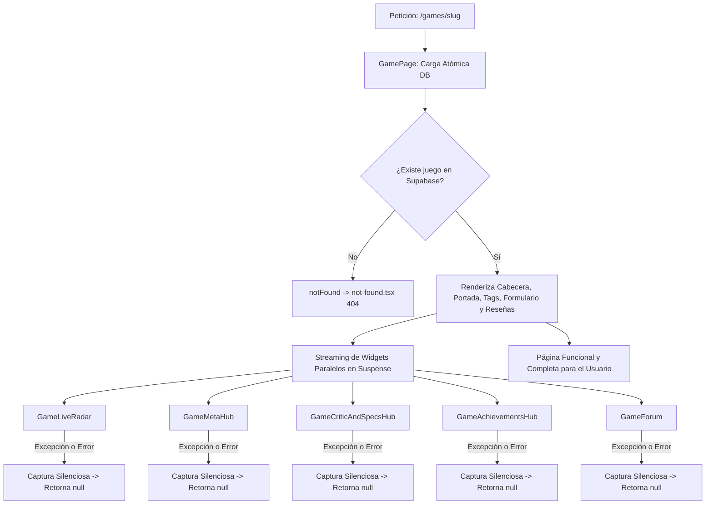

# SPEC-19: Aislamiento de Errores RSC y Resiliencia en Ficha de Juego (/games/[slug])

## 1. Contexto y Objetivos

### 1.1 Contexto del Incidente
En entornos de producción en Vercel, al navegar a ciertas fichas de juego (por ejemplo: `https://savestate-eight.vercel.app/games/god-of-war--1`), la página colapsa mostrando el Error Boundary global raíz (`src/app/error.tsx`):
- **Mensaje visible:** `ERROR CRÍTICO // CHECKPOINT CORRUPT: Se ha interrumpido la señal de la partida. Código de error: [3411904829]`.
- **Consola del Navegador (DevTools):** `Error: Minified React error #441; visit https://react.dev/errors/441`.
  - Este error de React 19 / RSC corresponde a: *"An error occurred in the Server Components render. The specific message is omitted in production builds to avoid leaking sensitive details. A digest property is included on this error instance which may provide additional details about the nature of the error."*

### 1.2 Diagnóstico y Análisis de Causa Raíz
1. **Falta de Error Boundary en Segmento de Ruta (`/games/[slug]`):**
   Actualmente no existe `src/app/games/[slug]/error.tsx`. En Next.js App Router, cuando un Server Component o un componente hijo de la página arroja una excepción no manejada durante el streaming o renderizado SSR, Next.js no puede confinar el fallo al contenido de la ficha y escala la excepción hasta el `src/app/error.tsx` global de la raíz, reemplazando toda la interfaz (incluyendo el layout principal).
2. **Limitación Estructural de `<Suspense>` en RSC:**
   `<Suspense>` en React solo intercepta promesas *pendientes* (estados asíncronos de carga para mostrar fallbacks/skeletons). **`<Suspense>` no captura excepciones sincrónicas ni asincrónicas en Server Components**. Si un servicio externo o función de renderizado falla o arroja un error dentro de `<GameLiveRadar>`, `<GameMetaHub>`, `<GameCriticAndSpecsHub>`, `<GameAchievementsHub>` o `<GameForum>`, la excepción atraviesa el `<Suspense>` e impacta directamente a la página.
3. **Puntos de Falla en Transformaciones de Datos:**
   - **Formateo de Fechas sin Validación en Speedrun:** En `GameMetaView` (`src/components/game-meta-hub.tsx`), la expresión `new Date(speedrun.dateIso).toLocaleDateString(...)` arroja un `RangeError: Invalid time value` fatal si `speedrun.dateIso` es una cadena no parseable o incompleta devuelta por la API pública de Speedrun.com.
   - **Slugs con Sufijos Duplicados de IGDB (`god-of-war--1`):** IGDB numera colisiones de títulos con sufijos como `--1`, `--2` (ej. God of War 2018 vs God of War 2005). Los selectores DOM, identificadores de pestañas (`safeId`) y consultas de portadas deben soportar estos slugs sin romper la generación de atributos HTML ni las consultas de metadatos.
   - **Mapeo de Logros de Steam:** La estructura de `percentages` devuelta por `valve-ssr-data` en Steam Community puede presentarse como un diccionario indexado por `internal_key` numérico o alfanumérico, requiriendo coerciones seguras para no indexar valores `undefined`.

### 1.3 Objetivos de la Solución
1. **Confinamiento Local de Errores (`src/app/games/[slug]/error.tsx`):**
   Crear un Error Boundary específico para el segmento `/games/[slug]` que mantenga la navegación de la ficha, muestre un panel de recuperación con estética SaveState y permita reintentar la sincronización sin destruir el layout general.
2. **Blindaje de Widgets de Terceros (Fallo No Fatal):**
   Asegurar que si cualquiera de los widgets externos (Radar en vivo, Meta Intelligence, Crítica/Requisitos o Salón de Trofeos) falla por red, API caída o datos atípicos, el widget simplemente se oculte o muestre un estado neutro, **pero la ficha del juego (portada, título, sinopsis, plataformas, reseñas y guardado en biblioteca) cargue siempre al 100%**.
3. **Sanitización y Validación Defensiva de Datos en Componentes:**
   - Validar fechas con `Number.isNaN(Date.parse(...))` antes de instanciar `new Date().toLocaleDateString()`.
   - Normalizar de forma determinista cualquier `safeId` para atributos `name` e `id` en inputs de radio / tabs.
   - Garantizar que todos los valores renderizados como hijos de React (`ReactNode`) sean primitivos seguros (`string`, `number`) y nunca objetos ni arrays no procesados.

---

## 2. Archivos a Crear y Modificar

| Tipo | Ruta | Acción | Propósito |
| :--- | :--- | :---: | :--- |
| **Doc** | `docs/specs/SPEC-19-game-detail-rsc-resilience-and-error-isolation.md` | Crear | Esta especificación técnica. |
| **Route** | `src/app/games/[slug]/error.tsx` | Crear | Error Boundary específico del segmento de juego para atrapar fallos de renderizado y ofrecer recuperación contextual. |
| **Component** | `src/components/resilient-widget-boundary.tsx` | Crear | Componente de cliente con `ErrorBoundary` de React para aislar fallos de widgets dinámicos y prevenir propagación a la página. |
| **Component** | `src/components/game-meta-hub.tsx` | Modificar | Sanitización de fechas en Speedrun (`Date.parse`), blindaje ante categorías atípicas y comprobaciones defensivas de ProtonDB. |
| **Component** | `src/components/game-critic-and-specs.tsx` | Modificar | Sanitización estricta de `safeId` para identificadores de radio buttons y blindaje de parsing de requisitos PC. |
| **Component** | `src/components/game-achievements.tsx` | Modificar | Normalización segura del mapa de porcentajes de Steam y prevención de valores nulos o `NaN` en barras de rareza. |
| **Page** | `src/app/games/[slug]/page.tsx` | Modificar | Envolver los widgets en límites de resiliencia (`ResilientWidgetBoundary` o wrappers tolerantes a fallos) y garantizar carga atómica del juego. |
| **Tests** | `tests/unit/game-detail-resilience.test.ts` | Crear | Pruebas unitarias de aislamiento de fallos, parsing seguro de fechas/IDs y resiliencia de widgets. |

---

## 3. Contratos de Tipos Estrictos (TypeScript)

### 3.1 Contrato del Error Boundary del Segmento
```typescript
// src/app/games/[slug]/error.tsx
'use client';

export interface GameSegmentErrorProps {
  error: Error & { digest?: string };
  reset: () => void;
}
```

### 3.2 Contrato del Resilient Widget Boundary
```typescript
// src/components/resilient-widget-boundary.tsx
'use client';

import React from 'react';

export interface ResilientWidgetBoundaryProps {
  children: React.ReactNode;
  fallback?: React.ReactNode;
  widgetName?: string;
}

export interface ResilientWidgetBoundaryState {
  hasError: boolean;
  error?: Error;
}
```

### 3.3 Validación Segura de Fechas ISO
```typescript
// En src/domain/game-meta.ts o función utilitaria
export function safeFormatIsoDate(isoString: string | null | undefined): string | null {
  if (!isoString || typeof isoString !== 'string') return null;
  const timestamp = Date.parse(isoString);
  if (Number.isNaN(timestamp)) return null;
  return new Date(timestamp).toLocaleDateString('es-CL', { timeZone: 'UTC' });
}
```

---

## 4. Algoritmo y Flujo de Lógica Paso a Paso

### 4.1 Jerarquía de Resiliencia en Cascada


### 4.2 Paso a Paso de Implementación

1. **Creación de `src/app/games/[slug]/error.tsx`:**
   - Componente cliente `'use client'`.
   - Renderiza un panel estilizado dentro del contenedor de la ficha de juego:
     - Título: `SEÑAL DEL JUEGO INTERRUMPIDA // RECONEXIÓN`.
     - Descripción: `No se pudieron cargar todos los datos de esta ficha técnica. Puedes reintentar la conexión o volver al catálogo.`
     - Botón `Reintentar` (`onClick={() => reset()}`).
     - Botón `Volver al catálogo` (`href="/explore"`).
     - Si existe `error.digest`, mostrar código para depuración.

2. **Creación de `src/components/resilient-widget-boundary.tsx`:**
   - Clase `React.Component` con `componentDidCatch(error, errorInfo)` y `getDerivedStateFromError`.
   - Si ocurre un error de renderizado en cualquier componente hijo cliente, captura el fallo y retorna `this.props.fallback ?? null`.
   - Registra el error en telemetría o consola sin romper el árbol React superior.

3. **Blindaje de Fechas en `src/components/game-meta-hub.tsx`:**
   - Sustituir `new Date(speedrun.dateIso).toLocaleDateString(...)` por una función pura que valide `Date.parse(speedrun.dateIso)` y verifique `!Number.isNaN(timestamp)`.
   - Si la fecha es inválida, omitir la etiqueta `<time>` sin lanzar excepciones.

4. **Sanitización de `safeId` en `src/components/game-critic-and-specs.tsx`:**
   - Asegurar que `safeId` remueva guiones dobles y caracteres no alfanuméricos:
     `const safeId = (title || 'game').toLowerCase().replace(/[^a-z0-9]+/g, '-').replace(/^-|-$/g, '') || 'game';`
   - Garantizar que los radio buttons de especificaciones mínimas y recomendadas tengan atributos `id` y `htmlFor` perfectamente emparejados y válidos para W3C.

5. **Blindaje de Mapa de Logros en `src/services/game-achievements-service.ts`:**
   - Asegurar que si `percentages` viene como objeto de pares clave-valor (`{ "256": 6.59 }`), la indexación coercione tanto a string como a número:
     `const rawPct = percentagesMap[internalKey] ?? percentagesMap[Number(internalKey)] ?? percentagesMap[String(internalKey)];`
   - Si no se encuentra porcentaje, asignar `0` por defecto sin romper la ordenación ni el resumen.

6. **Blindaje de la Página en `src/app/games/[slug]/page.tsx`:**
   - Garantizar que cada bloque `<Suspense>` contenga un fallback visual neutro y envolver los widgets en Server Components que capturen cualquier error síncrono o asíncrono con bloque `try { ... } catch { return null; }`.

---

## 5. Criterios de Aceptación Deterministas

1. **Prueba de Slugs Complejos (`god-of-war--1`):**
   - La ruta `/games/god-of-war--1` debe cargar exitosamente en producción (código HTTP 200), mostrando la portada, sinopsis, plataformas, radar, metadatos, requisitos de hardware y logros de Steam sin arrojar el error boundary `[3411904829]`.
2. **Tolerancia Total a Fallos en APIs Externas:**
   - Si Steam, IGDB, ProtonDB, Twitch o Speedrun.com fallan, devuelven HTTP 500 o responden con datos vacíos/corruptos, la ficha del juego **debe seguir cargando con normalidad** ocultando con gracia el widget afectado.
3. **Segment Error Boundary Funcional:**
   - Si ocurre un error fatal imprevisto en `/games/[slug]`, debe activarse `src/app/games/[slug]/error.tsx` manteniendo la cabecera, navegación y pie de página intactos, sin redirigir al error boundary raíz.
4. **Validación de Fechas Segura:**
   - Ninguna fecha nula, vacía o con formato inválido debe arrojar `RangeError: Invalid time value`.
5. **Calidad de Código y Suites de Prueba:**
   - `npm run typecheck` (`tsc --noEmit` y `next typegen`): 0 errores.
   - `npm run lint` (`eslint .`): 0 advertencias y 0 errores.
   - `npm run format:check` (`prettier --check`): 100% de cumplimiento.
   - `npm test`: 100% de las pruebas unitarias existentes (484 tests) más las nuevas pruebas de resiliencia deben pasar exitosamente.
   - `npx next build --webpack`: Compilación de producción limpia sin errores en ninguna de las 63 rutas.
