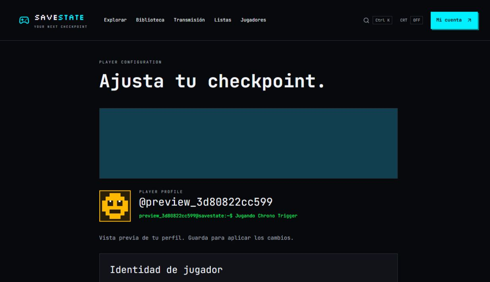

# Vista previa del perfil en ajustes

Solicitud del usuario del 7 de octubre de 2026: ver el avatar y el fondo propios en los ajustes, con el mismo diseño de la vista pública.

`ProfileIdentity` comparte el banner, avatar, nombre y terminal entre el perfil público y los ajustes. La vista previa carga las imágenes guardadas y refleja los cambios de galería, subidas completadas, nombre, color y estado antes de guardar. El perfil se persiste con la acción Guardar existente. Sin imágenes se mantienen el fondo y avatar predeterminados.

No cambia el modelo de datos, las reglas de privacidad ni el proceso de subida. No requiere dependencias, migraciones o variables nuevas.

Verificación local: `npm run check` correcto (16 tests), build de producción correcto y comprobación visual con una cuenta temporal. Se confirmó que el banner guardado carga desde Supabase Storage (1600 píxeles), que el avatar de galería y el estado cambian en la vista previa y que Guardar finaliza correctamente. Las imágenes y la cuenta de prueba se eliminan al terminar.

Pendiente de publicar mediante un nuevo despliegue de Vercel.

